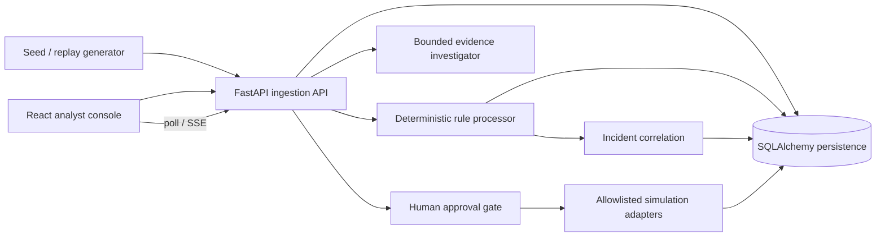

# Sentinel AI

Sentinel AI is a local-first, synthetic-data SOC demonstration. The first release is a modular monolith: FastAPI API, SQLite persistence for zero-setup runs, deterministic processor and replay worker, and a React/Vite analyst console. PostgreSQL and Redis are provided as optional Compose services for deployment-oriented work; SQLite mode is deliberately the easiest demo path. No action adapter contacts a real host or network.

## Run locally

Requirements: Python 3.11+ and Node.js 20+. In one terminal:

```powershell
python -m venv .venv
.\.venv\Scripts\Activate.ps1
pip install -r requirements.txt
uvicorn sentinel.main:app --reload
```

In another terminal: `cd frontend; npm install; npm run dev`. Open the [local dashboard](http://localhost:5173) and API docs at http://localhost:8000/docs. Seed synthetic telemetry with `python -m sentinel.seed --count 500`. SQLite database defaults to `./sentinel.db`; set `SENTINEL_DATABASE_URL` to a SQLAlchemy URL for PostgreSQL. No credentials or live telemetry are included.

## Share a browser demo

[](https://render.com/deploy?repo=https%3A%2F%2Fgithub.com%2FTruSegone%2FSENTINEL-AI)

Click the button, sign in to Render, and approve the Blueprint. Once deployment finishes, Render provides an `onrender.com` URL that you can share to open the dashboard. The public demo is seeded with synthetic events and uses the public `demo-analyst` identity; response actions only change Sentinel's simulation state. Free instances can sleep when idle, and their local SQLite data is temporary. This is for demos, not production or sensitive data.

This is a demonstration deployment. `SENTINEL_DEMO_TOKEN` defaults to `demo-analyst`; privileged actions require `X-Analyst-Token` and `X-Analyst-Role` (`admin` for approval/execution). This header-based demo identity is not production authentication. Set a unique token before sharing the service. To start the API with PostgreSQL and Redis, copy `.env.example` to `.env`, replace the placeholder `POSTGRES_PASSWORD`, then run `docker compose up --build`; Redis is provisioned for the next worker iteration and is not yet used as an event queue.

## Architecture and trust boundaries



The HTTP boundary validates and bounds input. Stored event text is untrusted and is never interpreted as instructions. The investigator only receives an incident's bounded event evidence and validates citations against that package. No LLM calls are enabled in this build. Response adapters update Sentinel's own simulation state only. SQLite is suitable for local demonstration, not multi-writer production. The initial processor is synchronous and intentionally simple; Redis buffering and high-rate load performance are not claimed. Configure PostgreSQL/Redis and a durable worker before production use. Auth, tenant isolation, secrets, TLS, rate limiting and audit-log tamper protection need a production identity and operations design.

## Detection notes

Rule definitions are versioned in `sentinel/detection.py`; each finding stores exact evidence IDs, confidence, technique reference and a deduplication key. ATT&CK mappings link only to supported behavior: T1110 for repeated authentication failures, T1078 for suspicious successful authentication, T1059 for unusual process execution, T1068 for privilege escalation signals, and T1071.004 for DNS activity. A technique mapping is a detection hypothesis, not proof of adversary use. New-source-IP comparison is a simple stored-event baseline; Isolation Forest feature extraction and metadata are exposed, while the model remains cold until trained. The deterministic rule path does not depend on scikit-learn.

## Replay, response and operations

Scenario data is deterministic for a seed. Replay creates events one at a time through the same ingestion function. It supports start, pause, resume, cancel and reset, with session progress persisted. Response actions bind a canonical payload hash and expire; execution requires approved state and uses only registered in-memory simulation adapters. Metrics are available at `/metrics`; health/readiness are `/health` and `/ready`. Event APIs are paginated and filterable. The frontend polls API-backed views and uses SSE for event updates.

## Development

Formatting conventions are configured in `.editorconfig`, `pyproject.toml`, and `frontend/.prettierrc.json`. Run `ruff format sentinel tests scripts migrations` and `ruff check sentinel tests scripts --select E4,E7,E9`; in `frontend`, run `npm run format` and `npm run build`. The environment used to create this workspace could not reach package registries, so those formatters and runtime checks could not be installed or run here. `python -m scripts.evaluate` reports a held-out synthetic rule benchmark; `python scripts/benchmark.py` measures local synthetic ingestion. Numbers must be recorded from an actual run and are not pre-claimed. The default compose file starts PostgreSQL and Redis for integration experiments; app configuration stays explicit. See `docs/THREAT_MODEL.md` and `docs/API.md`.
